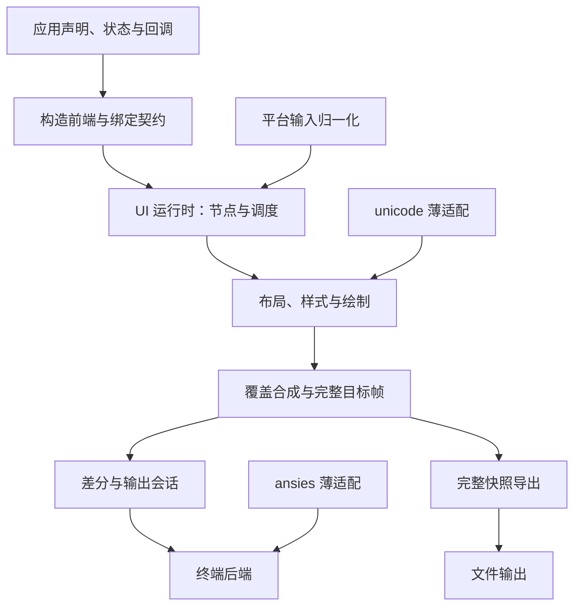
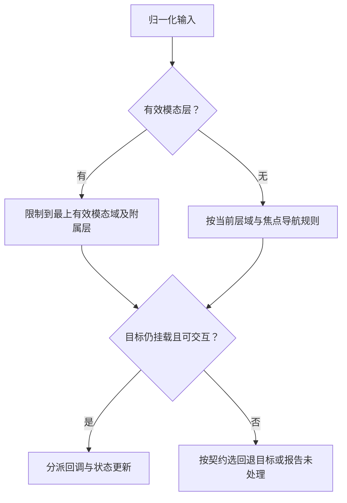
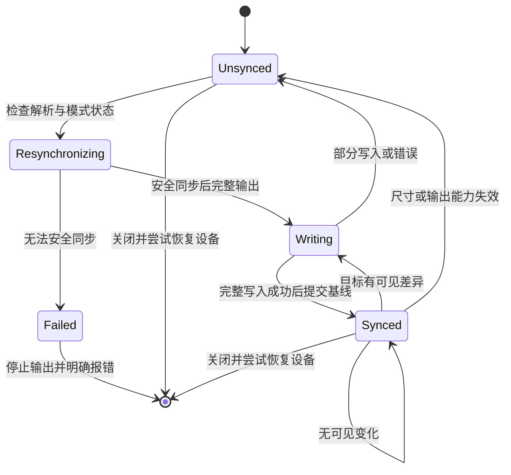

# cjtui 总体架构设计

## 1. 定位与设计成熟度

本文回答“系统由什么组成、各自负责什么、数据如何流动、怎样保持一致并从失败中恢复”。它是产品总体参考架构，不是目录说明或已经完成的实现报告。产品动机见 [整体提案](development/proposal.md)，外部行为见 [需求说明](requirements.md)，使用方式见 [用户构造设计](ui-construction.md)。

已确定：仓颉实现、包名 cjtui、约定 ArkUI 语法、指定中心仓依赖、字符终端语义和治理边界。当前尚无新产品源码；以下模块和概念模型是职责设计，不代表已存在的仓颉类、函数或冻结签名。语法、依赖能力和平台矩阵须按 TASK-001–004 获授权调查后冻结。本轮不进行这些实验，不开始功能实现。

| 设计层次 | 当前可确定内容 | 尚不能宣称 |
|---|---|---|
| 系统边界与不变量 | 前后端职责、状态归属、区域与帧不变量 | 实际运行已满足 |
| 模块与数据契约 | 输入/输出语义、所有权、依赖方向 | 精确包布局和函数签名已冻结 |
| 实现机制 | 完整帧再差分、统一调度、依赖薄适配 | 宏路线/库 API/平台接口已实测可用 |
| 证据状态 | 环境配置和 SDK 可用性已有记录 | 产品、示例、基准或 bundle 已通过 |

## 2. 设计目标与边界

首要目标是应用构造方便，其次以统一模型实现布局、状态和多层交互，再保证字符与输出正确。常规应用仅提供声明与回调，不协调缓冲、ANSI 或刷新。用户自定义组件和内置组件共享公开构造契约，不能因某个示例需要而绕开内核边界。

产品不依赖 Node、OpenSpec 或 Superpowers；这些只在开发仓库使用。系统不包含 JS/TS 运行时、完整 ArkUI SDK、CSS 引擎、PTY、Shell 执行或桌面窗口系统。业务数据所有权始终属于应用。

## 3. 系统上下文与信任边界

| 边界 | 输入 | 输出 | 约束 |
|---|---|---|---|
| 应用 → cjtui | 组件声明、可观察状态、回调、配置 | 生命周期通知、受控引用、诊断 | 不向应用暴露任意设备写入作为常规入口 |
| 系统终端 → 平台适配 | 键盘字节/事件、尺寸、设备状态 | 归一化事件、能力信息或明确未知 | 不将原始字节直接作为业务事件或富文本执行 |
| cjtui → 终端 | 经过区域/能力约束的屏幕更新和模式控制 | 完整或部分写入结果 | 所有输出由统一后端拥有 |
| cjtui → 文件 | 完整合成帧、导出格式及选项 | 彩色/纯文本快照或写入错误 | 不消费终端历史差分作为独立快照 |
| cjtui → 外部库 | 结构化字符/样式及解析请求 | 库支持的计算和序列结果 | 库不拥有组件树、业务状态或刷新决策 |

平台适配和文本 ANSI 输入是两条不同入口。终端回复解析、键盘归一化、富文本解析不得因为都包含 ESC 而混成一个任意透传通道。

## 4. 逻辑架构与依赖方向

图示依赖表达职责，不预设每个节点一定是独立包。前端不得写终端；后端不得决定布局；文件导出不经终端差分；外部库不参与业务节点所有权。

### 4.1 模块职责及语义接口

| 模块 | 消费 | 产生 | 不负责 |
|---|---|---|---|
| 构造前端 | 源码中的组件块、链、条件/列表、状态和回调 | 可执行构造规则、绑定定义、源码诊断映射 | 运行设备输出、平台服务兼容 |
| 公共组件层 | 声明属性、内容与子组件 | 通用组件描述和公开组合能力 | 私有业务特判、单独刷新通道 |
| 节点与生命周期 | 描述更新、稳定 key、挂载/卸载请求 | 有身份的运行节点、资源登记及清理 | 销毁应用业务对象 |
| 状态与 UI 调度 | 状态失效、业务回调、后台提交 | 有序 UI 更新批次和失效范围 | 任意线程直写节点/缓冲 |
| 样式与能力策略 | 显式属性、样式、主题、能力覆盖 | 解析后结构化样式和降级结果 | 全套 CSS 或字体控制 |
| 布局 | 尺寸约束、内容度量、容器规则 | 布局/内容区域、局部坐标转换 | ANSI 或业务输入处理 |
| 焦点与事件路由 | 归一化事件、节点有效性、层输入规则 | 选定目标与回调、焦点迁移 | 仅凭视觉层顺序无条件抢焦点 |
| 覆盖层管理 | 宿主、锚点、所有者、模态标志 | 层栈、有效输入域、合成顺序 | 复制旧屏幕作为关闭恢复策略 |
| 绘制上下文 | 区域、裁剪、解析样式、字符内容 | 受控字符绘制与装饰 | 节点直接访问全屏缓冲或 stdout |
| 帧合成 | 主界面和层绘制结果 | 单一完整目标帧 | 将透明当带背景空格 |
| 差分与输出会话 | 当前目标帧、最后成功基线、尺寸 | 输出批次及同步状态 | 在部分失败后假设基线有效 |
| 终端后端 | 输出批次、模式控制、能力策略 | 设备写入/错误及恢复结果 | 业务布局、组件生命周期 |
| 快照导出 | 同一完整帧、格式/换行策略 | 独立 ANSI/纯文本内容及文件错误 | 复用终端差分字节作为完整文件 |
| 外部库适配 | 框架的字符与样式契约 | unicode/ansies 的受支持结果 | 复制算法、数据表或包揽库全部 API |

接口首先冻结输入、输出、所有权与错误边界，再确定仓颉签名。不得让下游编码者凭模块标题自行猜测公共 API；TASK-004 必须交付精确契约后，相关实现任务才准入。

## 5. 公共构造与前端设计

### 5.1 前端输入与输出

输入采用 ArkUI 的组件块嵌套、属性链、状态声明与绑定、条件/列表、自定义组件和事件绑定形式；业务类型、表达式与函数仍使用仓颉。前端输出是供运行时调用的构造规则和绑定定义，不能只把某一时刻值序列化为静态树。

前端必须保存诊断与原始源码的关联，让未知属性、不支持语法和绑定错误能够定位。源码形式、宏调用方式、生成物位置、构建命令和编辑器限制都属于调查后的冻结内容。

### 5.2 路线比较及技术门槛

| 方案 | 优点 | 代价与使用条件 | 当前处置 |
|---|---|---|---|
| 仓颉现有能力与宏 | 复用仓颉类型、表达式与工具链 | 必须实证组件块及完整绑定需求可表达、可诊断 | 优先验证，未宣称可行 |
| 仓颉实现的专用前端 | 可明确处理声明式源码与诊断 | 增加语法处理、构建集成和维护成本 | 现有能力不足时用证据比较，不提前实现 |
| 普通函数/对象配置替代组件块 | 实现入口简单 | 改变已确定的公开构造目标 | 不作为无须裁决的降级方案 |
| 引入 ArkTS/JS/TS 运行环境 | 可复用另一生态部分能力 | 违反当前运行时边界 | 排除 |

当前只确定验证顺序与不允许的替代，不为尚未验证的语法写伪可运行代码。前端不会将任意不支持语法静默当普通文本。

## 6. 核心数据模型与所有权

以下名称为概念模型标签，非已发布类型签名。

| 模型 | 必需语义 | 所有者 / 生命周期 |
|---|---|---|
| 业务状态 | 应用数据、动作和可观察值 | 应用拥有，可长于任一视图 |
| 组件描述 | 类型、属性计算、事件、子描述及声明位置 | 构造阶段生成，可重新计算 |
| 节点身份 | 父身份、声明位置、显式 key 的稳定关系 | 运行时拥有，挂载期间有效 |
| 运行节点 | 当前属性、子关系、局部状态、布局和资源登记 | 挂载创建，卸载清理 |
| 绑定与订阅 | 计算规则、依赖、订阅取消及目标有效性 | 节点/绑定拥有，卸载释放 |
| 组件引用 | 定位受控操作目标，包含有效性信息 | 应用持有句柄，运行时验证挂载有效性 |
| 归一化事件 | 平台已解释的输入与目标上下文 | UI 调度处理，不持有无界原始输入 |
| 区域与裁剪 | 布局、内容、绘制、交互区域及有效祖先裁剪 | 布局/绘制阶段维护 |
| 结构化样式 | 颜色、文本属性、显式复位和解析后有效值 | 公共样式模型及运行节点使用 |
| 字符单元 | 字符簇起始内容、样式、宽度及延续关系，或透明 | 帧/绘制目标拥有 |
| 覆盖层记录 | 所有者、宿主、锚点、显示顺序、输入/焦点规则 | 覆盖层管理器拥有，随所有者关闭 |
| 帧与同步状态 | 尺寸、完整目标单元、已成功输出基线及是否失同步 | 输出会话拥有，尺寸变化或失败使旧基线无效 |
| 能力配置 | 输出颜色/控制支持、字符策略、显式覆盖及来源 | 应用会话配置；改变时重新评价受影响内容 |

跨节点共享的是应用状态和不可变配置，不共享视图局部焦点或层所有权。列表重排通过稳定身份保留局部状态；重复/无效 key 的诊断策略在 TASK-004 冻结，不能默认将节点错误合并。

## 7. 状态更新与事件执行模型

### 7.1 单一 UI 执行域

参考方案采用一个受控 UI 执行域拥有节点树、订阅生命周期、焦点、层栈和目标帧。这里不要求某个特定线程 API，而是要求这些状态不被任意后台任务无同步修改。后台工作通过调度入口提交更新，绑定失效被收集为一个批次。

| 阶段 | 进入条件 | 处理与输出 |
|---|---|---|
| 输入归一化 | 终端输入或尺寸通知到达 | 形成受限事件，未知输入按契约处置 |
| 选择输入域 | 存在有效模态/非模态层 | 确定允许的层域、焦点及路由目标 |
| 业务回调 | 目标有效并支持事件 | 调用仓颉回调，产生状态变化或关闭请求 |
| 收集失效 | 可观察属性变化 | 合并内容、样式、尺寸及显隐失效；不立即每次写终端 |
| 重算和协调 | 批次到达调度边界 | 重算受影响构造/绑定，按身份增删/更新节点 |
| 布局与绘制 | 内容/尺寸/样式需重新评价 | 生成当前正确目标帧，随后差分输出 |

回调期间发生关闭/卸载时，后续动作必须重新核对节点/引用有效性。参考设计将结构性修改收敛至调度边界，避免遍历中使用已失效节点；具体排队与取消语义在公共契约冻结时明确。框架错误处理不回滚应用自己的业务事务。

### 7.2 状态绑定策略

生成式绑定与运行时依赖跟踪是候选内部机制。两者必须保持“表达式仍可重新计算、依赖可失效、卸载可取消、普通非可观察变量不保证自动更新”的外部契约。TASK-002/003 提供证据后，TASK-004 选择机制及限制，不在未验证时给出冻结 API。

## 8. 布局、样式与绘制设计

### 8.1 尺寸与区域

布局使用字符行和显示列，自上而下传递约束、自下而上汇聚内容度量，再安排最终区域。横纵/弹性分配必须冻结取整与余量顺序；布局不足按公开最小尺寸与裁剪契约处理，不通过负宽高或隐式越界补偿。

| 区域 | 语义 | 与阴影的关系 |
|---|---|---|
| 布局区域 | 参与父容器尺寸与位置分配 | 默认不因阴影扩展 |
| 内容区域 | 扣除边框/内边距后可放置内容 | 可作为子项有效裁剪的一部分 |
| 绘制区域 | 主体和允许装饰的实际写入范围 | 阴影可扩展，但受祖先有效裁剪限制 |
| 交互区域 | 可进入交互/导航的目标范围 | 默认不包含阴影 |

坐标转换和裁剪由绘制上下文集中提供，组件只看到自己的局部空间和有效区域。高级自定义绘制也必须经同一受控写入，不能绕过字符完整性与覆盖层规则。

### 8.2 样式与主题

样式解析按显式属性、可复用样式、主题、默认值的优先顺序处理。未设置、继承和显式复位是不同状态，不能混成某个任意颜色值。允许继承的文本属性单独列明，布局、边框和内边距不自动继承。

框架模型保存结构化颜色和属性；降级在能力适配边界完成。具体终端支持不足时允许配置覆盖，配置标明来源，不声称能够完全检测字形覆盖。仅颜色变化也使目标帧失效，不因文本相同而丢弃更新。

### 8.3 绘制和失效

每次生成目标帧时按统一度量、样式与裁剪写入。移动、缩小、关闭和阴影变化均考虑旧与新绘制范围。首版完整帧重建负责恢复底层当前内容；局部失效记录可以用于调度和后续优化，不能在没有证据时取代完整生成路径。

## 9. 多层、事件路由与焦点

组件树管理逻辑父子与生命周期；覆盖层通过明确宿主和锚点进入层栈，因此可以按契约超出触发组件内容区，同时继续服从宿主/祖先裁剪。不能临时绕过整个裁剪机制。

打开层时记录所有者、当前有效焦点及恢复意图。关闭父层先使附属层退出活动集合，释放相关资源，再在存活且可交互节点中恢复焦点；原节点失效时使用冻结的回退规则。层关闭过程中回调再卸载其他节点，也必须重新判定有效性。

显示顺序与输入权不是同一字段：非交互装饰可以在视觉最上层而不获得焦点；模态层限制的是下层输入，不要求暂停下层业务状态更新。关闭后重新合成当前底层状态，不回放旧屏幕快照。

## 10. Unicode、字符单元与合成不变量

1. 字符簇的首单元与延续单元形成完整关系；延续单元不独立保存可绘制字符。
2. 宽字符被覆盖、清空或裁剪时，要处理整个所属字符簇，不能只清半边。
3. 透明单元表示“不贡献绘制”，带样式空格表示“明确覆盖该单元”，两者合成结果不同。
4. 帧尺寸与坐标均经过边界验证；复制/缩放不能使延续关系指向帧外。
5. 相同内容、尺寸、Unicode 策略和能力配置得到相同结构化目标帧；不承诺不同字体的像素图形相同。

unicode 适配负责提供库实际支持的字符簇、宽度、码点属性和规范化能力。框架负责边界行为、模糊宽度/emoji 策略配置以及帧完整性。数据版本、组合符和 emoji 能力由 TASK-003 核实；不自行补一份未经维护的 Unicode 表。

## 11. 帧合成、差分与输出事务

合成按主画面与覆盖层顺序形成完整目标帧。差分比较的另一端只能是“设备最后完整成功显示的基线”，而不是上一次试图写出的帧。输出批次统一管理光标移动、样式变化、擦除及能力降级，组件不参与设备调用。

终端写入不是可回滚业务事务；“事务”仅指基线提交规则。若写入部分成功，物理画面可能已改变，因此只能标失同步并在下次完整重绘。不能通过把异常吞掉或提前清脏标志来声称一致。

部分写入还可能截断编码字节或 ANSI 序列，使终端解析/模式状态不再可知，因此完整目标帧本身并非充分恢复手段。参考契约要求后端仅对支持矩阵中已经验证的终端采用安全重同步步骤，确认可继续输出后再完整重绘；无法安全确认时停止该输出会话并明确报告失败，不盲目发送更多序列宣称恢复。具体中断边界、重同步与模式恢复方案归 TASK-008/020 的后续调查和故障验收，本轮不执行实验。

正常退出、异常和取消均进入统一清理路径，尝试恢复框架修改过的模式和光标状态；清理操作按参考设计应可重复调用，不在回调里散落相互冲突的恢复路径。设备不可写时明确记录恢复失败，不保证物理设备必然恢复。

## 12. ANSI 适配与独立文件快照

ansies 负责其已有的序列生成及适用解析。框架提供结构化样式映射、能力降级和安全边界。终端回复、应用富文本、设备输出使用分别定义的契约，不能因为库能解析某些回复就宣称支持所有 ANSI 输入。

受限增量输入适配保存有界未完成序列；支持类型、参数范围、终止条件、畸形/未知处理、缓存上限及文件结束处理均进入冻结矩阵。组件文本不得控制全局光标、切屏或突破区域；需要模式控制的操作仅由受控设备会话发起。

导出从完整合成帧生成 ANSI 彩色或纯文本内容，包含当前可见装饰与层。编码、行尾、空白背景、初始/结束样式为文件契约的一部分。文件失败不改变终端基线，终端失败也不能把一个未完成文件标为成功；没有独立授权不增加动态录制或其他导出格式。

## 13. 错误模型、可诊断性与资源边界

| 错误类别 | 诊断信息 | 恢复/处置边界 |
|---|---|---|
| 语法或绑定构建错误 | 原始源码位置、不支持项和预期形式 | 阻止错误构造进入运行；不静默忽略 |
| 参数/区域/身份错误 | 输入、目标、违反的契约 | 明确拒绝或按公开边界规则裁剪；具体规则冻结 |
| 无效引用/卸载目标 | 目标身份与当前有效性 | 不访问失效节点；回退、未处理或错误依操作契约 |
| 业务回调失败 | 事件来源、目标及失败原因 | 按会话错误策略处理，不伪造业务成功、不擅自回滚应用数据 |
| 终端输入/解析错误 | 类别与有限上下文 | 有界丢弃/诊断或公开回退；禁止无界缓存与设备透传 |
| 终端写入失败 | 批次范围、完整性与错误 | 使基线失效；安全重同步后完整重绘，无法确认则停止输出并清理 |
| 文件输出失败 | 目标、阶段和错误 | 不宣称文件完整，不修改设备基线 |
| 能力未知/受限 | 检测/配置来源及降级结果 | 只按公开策略降级，未知并非完整支持 |

具体错误类型与返回/异常签名在 TASK-004 冻结。诊断默认通过受控渠道返回应用或日志，不任意向全屏应用 stdout 插入文本破坏画面。订阅、输入解析缓存、层记录和缓冲均须有生命周期或尺寸上限，不能以无限保留资源避免处理失效。

## 14. 平台适配与并发边界

平台适配契约至少包括会话开启/关闭、尺寸读取与变更通知、输入获取/归一化、输出完整性和模式保存/恢复。Linux x64 / SDK 1.2.0 仅是当前工具与 CI 验证宿主；Windows、macOS 和具体终端的产品支持状态尚未冻结。

TASK-001 输出 OS × 终端 × TTY/非 TTY × 输入/缩放/恢复的矩阵；TASK-004 将可承诺项转成公开契约。非 TTY 的交互入口行为须明确拒绝或采用已定义模式，不能自动宣称完整交互可用；独立文件快照不以存在交互终端为前提。安全或兼容要求不能靠平台名称推测。

## 15. 模块组织与发布

| 路径 | 责任 | 交付属性 |
|---|---|---|
| src/ | cjtui 唯一活动主库，内部按职责组织 | 产品源码；尚未实现 |
| examples/minimal/、examples/composition/ | 公开入口示例与 smoke 模式 | 产品；尚未实现 |
| benchmarks/rendering/ | 可复核性能工作负载 | 产品；尚未实现 |
| docs/product/ | 使用与能力限制说明 | 产品文档 |
| docs/、openspec/specs/ | 整体提案、需求、架构、任务、规格和证据 | 开发资料，排除发布 |
| .agents/、scripts/、.github/ | 开发技能发现、检查及 CI | 开发基础设施，排除发布 |

根采用 CJPM package 而非 workspace，便于根主库的 include/exclude 限定产品源码制品。示例/基准的包内相对依赖必须在真实 bundle 和干净解包中验证，不以目录或配置推断必然可用。仓库 README 可使用指向在线仓库文档的绝对链接提供设计入口，避免把被排除的开发文件当作包内存在。

产品从需求和公开契约出发开发。TASK-001 调查产品平台与终端支持边界，TASK-024 汇总完整产品验收及发行准备。

## 16. 关键决策与替代方案记录

| 决策 | 采用方向 | 替代方案及未采用原因 | 验证/责任 |
|---|---|---|---|
| D-001 | 根主库、独立示例与基准项目 | 将演示/基准混入主库会扩大运行职责；根 package 提供一致的产品打包入口 | TASK-021、022、023 |
| D-002 | 中心仓依赖经薄适配接入 | 复制第三方算法会形成重复维护；向业务暴露全部依赖 API 扩大耦合 | TASK-003、004 |
| D-003 | 真实语法先验证，能力分切片 | 先假设宏可行会使后续签名和任务失真；普通函数替代改变目标 | TASK-002、004 |
| D-004 | 单一 UI 执行域与统一生命周期 | 任意线程直写树/帧增加状态竞争和资源失效风险 | TASK-015、016、017 |
| D-005 | 完整目标帧后差分，成功才提交基线 | 首版复杂局部重绘难以证明层遮挡/宽字符正确；提前提交掩盖失败 | TASK-005、007、008 |
| D-006 | 输出会话与文件快照分开消费帧 | 直接保存终端差分无法独立重现画面 | TASK-010、020 |
| D-007 | 项目文档长期维护，具体变更按编号映射 | 整项目文档与具体变更重复维护任务状态会导致漂移 | AGENTS 第 10.1 节 |
| D-008 | 制品白名单及实际清单检查，CI 分切片/最终验收 | 仅排除少数文件易泄漏；初次源码就要求未来项目完整会阻碍渐进交付 | TASK-021–024 |

这些是参考架构取舍，不代表用户已批准新的产品范围。D-004/005 等实现方向服务于已确认不变量；如果验证需要改变公开目标、契约或范围，按 Battle 准备证据并处理授权，不能由架构文档自行扩大决定权。

## 17. 验证架构与追踪

| 验证层 | 要证明什么 | 对应任务/证据 |
|---|---|---|
| 编译与负向语法 | 原始声明可构建、错误定位可信 | TASK-002/004，源码与命令记录 |
| 字符/布局单元不变量 | 宽字符完整、度量/区域/样式确定 | TASK-005/006/011–013，边界断言 |
| 合成与独立屏幕模型 | 主画面、层及差分输出不共享同一错误 | TASK-007/008/012/018，独立预期 |
| 状态与输入生命周期 | 重排、卸载、后台提交、失效引用、模态恢复 | TASK-015–020，事件和故障场景 |
| 用户构造集成 | U1–U5 易用、复用且无内核特判 | TASK-021，公开源码及操作证据 |
| 文件与真实终端 | 快照独立、模式恢复、实际能力限制 | TASK-010/020，文件和环境记录 |
| 性能与资源 | 固定负载、尺寸、版本和方法可重复 | TASK-022，不编造阈值 |
| 制品与最终集成 | 无开发泄漏、干净解包可用、完整发行准备 | TASK-023/024，真实清单与运行证据 |

参考方案至少维护目标帧和最后成功基线，帧内存随行列数增长；若存在逐层绘制目标，应记录层数与区域导致的额外空间。完整帧路径的工作量随画面规模增长，差分减少设备输出但不自动消除布局/绘制成本。是否引入局部重绘或缓存由基准证据决定，不能先承诺具体复杂度收益。

验证时机、必要范围和有效结果复用统一遵循 AGENTS 第 11 节，不把上述层次变成每次编辑都跑一遍的清单。产品结果只写 [验收矩阵](acceptance.md)，本文仅记录验证责任。

## 18. 设计冻结与后续执行边界

当前已完整描述系统职责、概念数据、输入/输出、生命周期和核心失败路径；精确源码语法、API 签名、平台矩阵、解析上限、焦点回退与布局取整等必须在 P1/P2 形成可复现结论。它们的结果允许细化实现，不允许未经裁决改变必需外部行为。

TASK-004 的冻结交付必须给出上述接口及边界，按要求更新需求、构造契约、OpenSpec 场景、任务输入和验收映射。未完成前，下游候选不能被称为 ready。本次只完善架构与说明，不将任何调查/实现任务标为 completed，不运行产品原型，不创建整项目变更目录。
