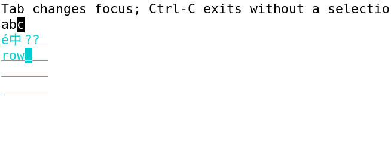
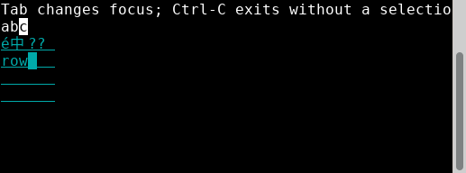
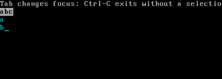

# Finite E editing evidence — 2026-11-13

Public `TextInput`/`TextArea` now provide single-line/multiline Unicode editing, cluster selection/navigation/deletion, undo/redo, optional controllers, callbacks, shared Canvas/theme/viewport rendering and conservative copy/cut. Independent TASK122 accepts **PASS_FINITE_E** for E001–E005/F003–F005 and AC028's editing scope: [acceptance](editing-acceptance/acceptance.md), [requirement matrix](editing-acceptance/requirement-matrix.md), [original index](editing-acceptance/index.json). Product usage: [editing](../../product/text-editing.md).

Accepted source: `22ca8cf7c756c5185064a6f8bc7e9f2c58d4f167`; integrated main product head: `b71cb2ebd740a22eba3759abd35b9b0fff068bdd`. Original initial product `043523cdb07d4de542174022dddfa5ed715b560d` maps to main `257d7f43fb8b944d2c6be049f27dd5a59b716bca`. Root verified product/tests/examples/product-doc bytes equal the accepted source; only four status documents differ. [Exact product/test aliases](controller/main-map.json) preserve the fixed inputs. All original receipts keep their original SHAs and absolute paths.

The finite TASK113–122 sequence is complete. The formal OpenSpec change remains active for final Linux TASK023/024 integration. Full Linux/AC041/024, parent030/020/019/027, M1/M2 and release remain unclosed; T087-G01→023 and B-M01→024 remain pending. [K archive](../K/README.md) is retained once at its existing location.

## Independent evidence and author proofs

- TASK118: [frozen tests and genuine RED](editing-tests/final/report.md), [original handoff index](editing-tests/final/handoff-index.json), [session mode supplement](editing-tests/session-mode-oracle/report.md), [callback validation](editing-tests/callback-validation-regressions/report.md), [review regression tests](editing-tests/review-round1/report.md). Initial setup/compile failures remain alongside successful prerequisite receipts; test-freeze success does not mean editing behavior had executed then.
- TASK119 author implementation evidence: [final author report](editing-implementation/task-119-report.md), [original handoff index](editing-implementation/handoff-index.json), [fix1 index](editing-implementation/fix1-index.json). The old report hash refers to the [preserved 043 report](editing-implementation/raw/fix1-report-preservation/task-119-report-043.md), with its [relocation receipt](editing-implementation/raw/fix1-report-preservation/relocation.json). Historical binaries remain local with [binary preservation](editing-implementation/raw/fix1-binary-preservation/relocation.json) and [runtime preservation](editing-implementation/raw/fix1-runtime-preservation/relocation.json). These proofs are author evidence, not independent acceptance.
- TASK120 independent fixed-source review: [initial specification/quality FAIL](editing-review/round1/report.md), [initial findings](editing-review/round1/findings.json), then [fix1 specification/quality PASS_FINITE_SOURCE](editing-review/round2/report.md), [closure proofs](editing-review/round2/index.json). All four Important findings I01–I04 are closed. The initial failing probes remain original failures.
- TASK121 independent execution: [actual report](editing-execution/report.md), [final index](editing-execution/final-index.json), [source/package/binary bindings](editing-execution/raw/source-bindings/bindings.json), [host qualifications](editing-execution/raw/qualifications/host-qualification.json). Ordinary build/bundle, clean packaged consumer, eight PTY vectors and four review selectors, example smoke, actual GUI and VT direct executions and termios restoration have their own original raw receipts. The bundle's own project-test count was zero; independent consumer evidence supplies behavioral coverage. Package SHA256 `9a953a26b9c848df4e1426fb218f4059891f3bc319206c054ed98d115b8a1a11`, 243 source-equal members and 40 unchanged test inputs are recorded. Valid unchanged Runtime/regression receipts are reused with explicit scope analysis.
- TASK122 independent finite acceptance: [specification/quality/evidence verdict](editing-acceptance/acceptance.md), [matrix](editing-acceptance/requirement-matrix.md), [selected-original check](editing-acceptance/selected-evidence-check.json), [original receipts](editing-acceptance/original-SHA256SUMS). Case counts do not replace these requirement judgments.

## Representative original host captures

These three images retain the original PNG bytes. XTerm398, XFCE4 Terminal1.1.4/VTE0.80.1 and QEMU10.0.13/kernel6.12.107 tty1 are distinct actual implementations. Captures support visual observations; process results, native VT cells and termios receipts establish their separate behavioral/restoration claims.

The [complete 61-image catalogue](png-catalog.md) and [machine-readable hashes/status](png-catalog.json) include early/in-progress/cleanup captures with explicit limits. Native `*-vcsa.bin` observations remain beside the VT screenshots. Settled VT-r2 shows a/LF/b across 60×12→50×10; earlier first-run/fast-r1 frames cannot substitute for it.

## Exact limits and historical failures

There is no current genuine Applied clipboard producer/integration. Unsupported and SentUnconfirmed preserve cut text/history; external delivery observed in XTerm does not upgrade the product result to Applied. VTE retained EXTERNAL-SENTINEL. Applied deletion/stale-result and UInt64 exhaustion remain source/manual-policy proof only. I04's precise early keyboard planning race is source-proven; observed CAS conflicts do not establish that exact scheduling interval.

GUI combining/CJK/emoji UTF8 input reached both hosts, but output emitted `??` for emoji under the documented automatic projection. No font-cause claim, universal glyph fidelity, IME or BiDi support is made. VT native ShiftLeft/ShiftEnd lose the modifier under the default keymap; CtrlA selection works. VT Unicode input, terminal paste, local clipboard delivery and physical hardware remain unverified; QEMU is a VM.

The initial registry-config build exit1, first VT collector exit1/supervisor75 and stale fast-r1 captures are preserved with later qualifying evidence. First VT product itself exited0/restored after no-selection CtrlC; later requested keys were not consumed in that failed collection. No original failed receipt is rewritten as a pass. Normal bundle lint warnings are not a lint-clean claim.

## Copy provenance and exclusions

[Source-copy index](source-copy-index.json) maps every copied original absolute path to its archive path, byte count and SHA256. [Exclusions index](exclusions-index.json) records omitted indexed artifacts, retained-original locations and reasons. Whole source/worktree/SDK/dependency/cache/target trees, ELF/libraries/objects/CJP and redundant guest tarballs are excluded. Native vcsa/termios observation data is retained. Public source is accessed by fixed Git SHA rather than another source copy. The [committed contract](controller/committed-contract/design.md) and its sibling files are explicitly fixed Git blobs, not reconstructed execution output. Official public registry URLs and truthful local provenance paths remain; actual config snippets contain no credentials.

This archive is a mechanical copy/status task. No functional builds/tests, product changes or asset re-review were performed. Required strict OpenSpec validation is recorded in [archive validation](archive-validation.txt); the complete repository metadata/link checker is deferred to the root's full checkout because this sparse worktree omits historical archives.
