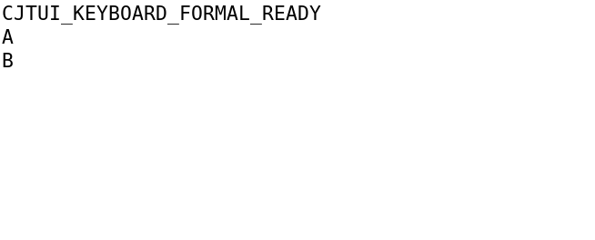
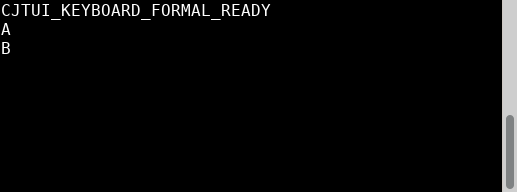
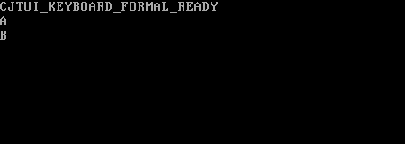

# Finite K evidence archive — 2026-11-13

Independent TASK117 verdict: **PASS_FINITE_K**, limited to K001–K004/F001–F003/F006–F007. [Original acceptance](keyboard-acceptance/acceptance.md), [findings](keyboard-acceptance/findings.json), [verification qualifications](keyboard-acceptance/verification.json), [original input index](keyboard-acceptance/index.json) and [manifest](keyboard-acceptance/manifest.json) remain byte-for-byte originals. This is a finite evidence archive, not OpenSpec whole-change archival or full Linux acceptance. TASK114–117 are complete; actual TASK118 test work is in progress and TASK119–122 remain pending.

## Fixed inputs and integration aliases

Accepted product source: `c3c4642d84df57bbd9550d222ed22f602acd13ef`. Main code head: `da9eaf4044cba917d12f441e041e164deb5eff80`. Root verified all product paths byte-equal to the accepted source; commits differ because main integrates fixed commits. Originals retain their original SHA and absolute workspace paths. [Root alias map](controller/.superpowers/sdd/tasks-implement-linux-input-editing/task-K-main-map.json):

| Original product commit | Main alias |
|---|---|
| `2cc38e3a4edc0818b627f649e1c340cbd340aec2` | `5067deac16e78cebf40fac8409dda76979155a43` |
| `c643d5e773ebf160ff29a0b1fafe57962f3cfdec` | `f620b4e2d6f8c27149fb017208b8c78ece5f50e7` |
| `c80e5e4130aea89dd0177cfb10f4a235d64be090` | `f640ea4274d0791a89f023a15f844764b85d3e5e` |
| `5baa09f33251e9f572640a2f6d4ae46245f7eea8` | `c1f5467b1ad12062d902d5a8a4a8fa3eaaa9267e` |
| `500d5ff35632ab7ed55e323458883bbd7e80d2b7` | `5e621ed90519dfb0a7bb018a5f144eaecb46945a` |
| `c3c4642d84df57bbd9550d222ed22f602acd13ef` | `da9eaf4044cba917d12f441e041e164deb5eff80` |

Test aliases: `86126246→f7ec9f0f`, `91697a73→e4753795`, `bce5b9c9→cb3fac0a`, `cb636485→430eb63f`. Independent integration fixture overlay `daf99aa1f323929d09907d558623b3bb6a74cbbb` maps to main `c7886644`. The exact two added fixture lines select explicit `GlyphMode.Unicode` and explain the virtual parser profile; no emoji oracle, parser, or product Auto fallback changed. [Original diagnosis](keyboard-tests/integration-diagnosis/report.md), [fixed fixture qualification](keyboard-tests/integration-profile-fix/report.md) and exact patch remain preserved. This overlay supplies no new product behavior.

## Evidence chain

* Initial [preflight failure](input-preflight/report.md) and [88ed5f7 closure](input-preflight-resume/scoped-report.md) are distinct issued reports; historical readiness values remain historical.
* [Formal113 test freeze](keyboard-tests/final/report.md) preserves genuine missing-API and native EOF/tail REDs, alongside the successful upstream baseline. Additional paste-argument, I015 and two review regression reports/raw retain their issued verdicts.
* [TASK114 report](keyboard-implementation/task-114-report.md), [original phase index](keyboard-implementation/phase-index-final.txt), [fix-round1 index](keyboard-implementation/review-r1-index.txt) and [fix-round2 index](keyboard-implementation/review-r2-index.txt) retain only explicitly indexed phase directories. Raw failures, source patches, pre/post hashes and binary hash receipts are preserved; no missing historical snapshot was reconstructed.
* Independent source115: [initial FAIL](keyboard-review/round-01/report.md) → [fix-round1 FAIL](keyboard-review/round-02/report.md) → [fix-round2 spec/quality PASS](keyboard-review/round-03/report.md). All original findings and raw-only controller input indices remain unchanged. The final small fix closes K115-R1-01 and its parent K115-04; five earlier findings remain closed.
* [Actual116 execution report](keyboard-execution/report.md) and [stable manifest](keyboard-execution/stablemanifest.json) bind 2826 original assets/487496169 bytes. Sixteen required phases exit0: main build, keyboard dispatcher, native-session, lifecycle, runtime-session, corrected integration, mandatory ordinary bundle, corrected finite package audit, three clean consumer build/run pairs, GUI hosts and settled VT host. Exact commands, stdout/stderr, exits, phase manifests, source/binary bindings and collection tools remain in their original hierarchy.
* The original integration exit1, first VT collector framing failure, and obsolete `keyboard.md` package-audit exit1 remain original failures. Later corrected-profile/collector/audit receipts qualify them; no old receipt is rewritten as passed. Earlier A idle expectations and attempts missing the SDK runtime remain qualified historical evidence, not a complete current-K suite claim.
* Mandatory ordinary `cjpm bundle` exited0 without skip; local CJP SHA256 `e3196fccc18ff3fe3889245ad46d789abf52af5f2384fe7b36444f685f8e00f9`. All229 members were safe and source-equal, including public `keyboard-input.md`; clean external decoder, dispatch and bundled example builds/direct runs exited0. This finite audit does not replace T087-G01.
* [Independent117](keyboard-acceptance/acceptance.md) accepts the finite contract using fixed source proofs, fresh selective hashes and valid same-input executions under AGENTS11.1. The archive performs copy/metadata verification only; no functional rebuild or cold re-execution.

## Original actual-host images

XTerm398, XFCE1.1.4/VTE0.80.1 and QEMU10.0.13 Linux kernelVT are three actual distinct implementations, with original versions, TTY/size, keys/wire, direct exits and cleanup evidence. These are original captured PNG bytes, not redraws. The settled resize observations are:

All17 PNGs are cataloged below and in the unchanged [original PNG catalog](keyboard-execution/raw/png-catalog.json). Its common qualification string is preserved; this wrapper distinguishes each actual image's phase.

| Original PNG | Phase qualification | SHA256 |
|---|---|---|
| [raw/host-vt-r2/keys.png](keyboard-execution/raw/host-vt-r2/keys.png) | preliminary VT r2 capture; superseded by settled r3 | `33d8416f3f6d2c3cd33ca4895d714eb6dd6a47d2f2cabe367a7f1237cd51a607` |
| [raw/host-vt-r2/resized.png](keyboard-execution/raw/host-vt-r2/resized.png) | preliminary VT r2 capture; superseded by settled r3 | `234eaa4c7af87e6101b6b1da512faec54a9b0aecefd43af28b9303db09d35713` |
| [raw/host-vt-r2/restored.png](keyboard-execution/raw/host-vt-r2/restored.png) | preliminary VT r2 capture; superseded by settled r3 | `9bf76c3899a7e45ae793e47fb7ed9e3222c067c9fb2afe72e589a73baabba2dd` |
| [raw/host-vt-r2/running.png](keyboard-execution/raw/host-vt-r2/running.png) | preliminary VT r2 capture; superseded by settled r3 | `ede258a78e0e726c9078a3e031669396e4725966ea50b4361a292ffff40dcc16` |
| [raw/host-vt-r3/keys.png](keyboard-execution/raw/host-vt-r3/keys.png) | keys/paste observation | `33d8416f3f6d2c3cd33ca4895d714eb6dd6a47d2f2cabe367a7f1237cd51a607` |
| [raw/host-vt-r3/resize-transition.png](keyboard-execution/raw/host-vt-r3/resize-transition.png) | resize transition; not settled | `153d838bcf43fee366cccafc4211baf9ff1dc0835c1e1462a6cec0216e0a1f88` |
| [raw/host-vt-r3/resized.png](keyboard-execution/raw/host-vt-r3/resized.png) | final settled resize | `ee4034c6689b0c3df85087784a4f3342996063123158f2f9097a9df75e4b14a2` |
| [raw/host-vt-r3/restored.png](keyboard-execution/raw/host-vt-r3/restored.png) | cleanup/restored observation | `9bf76c3899a7e45ae793e47fb7ed9e3222c067c9fb2afe72e589a73baabba2dd` |
| [raw/host-vt-r3/running.png](keyboard-execution/raw/host-vt-r3/running.png) | running observation | `ede258a78e0e726c9078a3e031669396e4725966ea50b4361a292ffff40dcc16` |
| [raw/host-vte/keys-paste.png](keyboard-execution/raw/host-vte/keys-paste.png) | keys/paste observation | `e6946e09e954004f0816af85c1b8010c23a4333703ae24b7da0f545b968ab7bf` |
| [raw/host-vte/resized.png](keyboard-execution/raw/host-vte/resized.png) | final settled resize | `7f2bc068a6fef0df8e91b642f9470b92e6ca1855dc080c95f9da27770dcc35cf` |
| [raw/host-vte/restored.png](keyboard-execution/raw/host-vte/restored.png) | cleanup/restored observation | `7f2bc068a6fef0df8e91b642f9470b92e6ca1855dc080c95f9da27770dcc35cf` |
| [raw/host-vte/running.png](keyboard-execution/raw/host-vte/running.png) | running observation | `e6946e09e954004f0816af85c1b8010c23a4333703ae24b7da0f545b968ab7bf` |
| [raw/host-xterm/keys-paste.png](keyboard-execution/raw/host-xterm/keys-paste.png) | keys/paste observation | `245cc9cca8a8a3d739a0c950bd4d44b84922947a64e0ef8add5b4ab988522aad` |
| [raw/host-xterm/resized.png](keyboard-execution/raw/host-xterm/resized.png) | final settled resize | `f142708e559bfcd88e9d9a235b646c18ffc291b8daf9f5e28dce68927f4a40a8` |
| [raw/host-xterm/restored.png](keyboard-execution/raw/host-xterm/restored.png) | cleanup/restored observation | `12c97af7bf7be833d68a21e106bf04d7fd807510732d9a8b8f271214e9bfde09` |
| [raw/host-xterm/running.png](keyboard-execution/raw/host-xterm/running.png) | running observation | `245cc9cca8a8a3d739a0c950bd4d44b84922947a64e0ef8add5b4ab988522aad` |

## Qualifications and remaining work

XTerm Alt+z produced UTF8 ú, so unprovided physical Alt distinction cannot be recovered. KernelVT ShiftTab produced tab and ShiftInsert produced insert; no VT backtab or paste support is claimed. Live callback code/text observations and frozen modifier assertions are separate evidence. GUI physical clipboard fixture setup is test setup, not a product clipboard dependency or ClipboardApplied proof. The VM kernelVT is not physical hardware. Natural real-host EOF and full IME were not exercised; actual OSpipe/TTY read0/POLLIN|HUP EOF is proven separately. Cleanup establishes requested2004 bytes and exact termios/resources; unknown cursor/display state and full host restoration remain unclaimed. Lint retains actual exit0, zero error severity and701 warnings.

AC003/004 normalization, AC017 paste-target bridge, AC030 paste reception, AC020 added-mode cleanup and AC041 input are segmented parent mappings only. Full Linux/AC024, full parent ACs, AC028 editing, menu/019/029, M2, showcase and other platforms remain pending. B-M01 stays deferred to024. T087-G01 full product checker remains mandatory at023, pending and not fixed by this archive. TASK118 is actual work in progress; no118 completion is inferred. TASK119–122 are unimplemented remaining work.

## Public copy boundary and local provenance

[source-copy.json](source-copy.json) lists every copied original's source/output path, size, SHA256 and category, and individually maps exclusions. Only explicit scoped reports/raw/indices, indexed implementation phases, issued preflight/review originals, collection provenance and exact indexed cleanup receipts are copied. Source/config snippets were inspected for benign content before copying; no credential-pattern matches were found. The [original accepted canonical design](controller/openspec/changes/implement-linux-input-editing/design.md) is preserved before the current design receives versioned status notes; frozen signatures, semantics and budgets are unchanged.

Every copied manifest/index is byte-equal to its local original, including references to excluded binaries, SDKs, intermediates, clean-unpacked trees and absolute local paths. Such paths are provenance references, not promises of corresponding public files. All local indexed originals, source trees, CJP and binaries remain untouched. Executables are classified by content as well as path, including binaries named `main`. ELF/CJP/shared libraries/objects/archives/cjo/bytecode, build/cache/SDK/dependency trees, VM/kernel/initramfs, symlinks and special files are excluded. The four60-byte binary termios snapshots are raw device-state receipts, not executable artifacts. No duplicate product source tree, old SDK/archive copy, unrelated A/B/C review package or whole R19 preparation was added. Full source is available at the exact Git SHAs above; no historical snapshots were reconstructed.

The archive wrapper/index are new explanatory records. Original reports retain their historical wording, path names, limits and verdicts. Repository/configuration/link/OpenSpec and copy verification results are recorded in [metadata-checks.json](metadata-checks.json). No release, PR, main push, other-OS or parent closure is performed here.

Original source115 round01 report contains `round-01/index.md` and `round-01/manifest.sha256` links relative to its own round directory. Two byte-equal nested alias copies keep those issued links usable; source-copy.json identifies both aliases. The original report and manifests were not edited.
