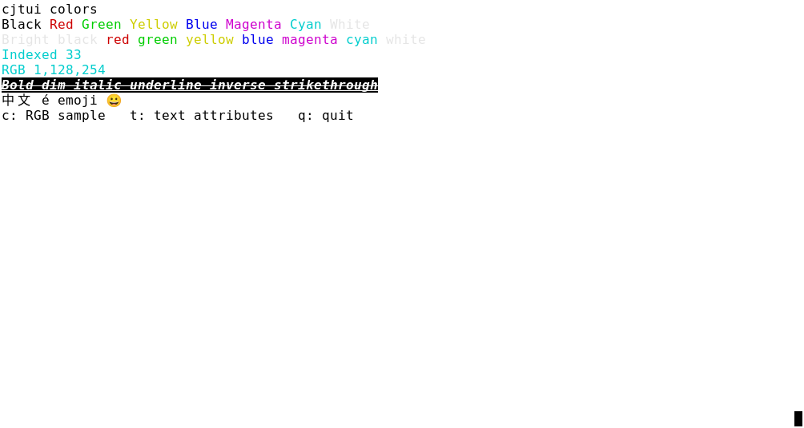
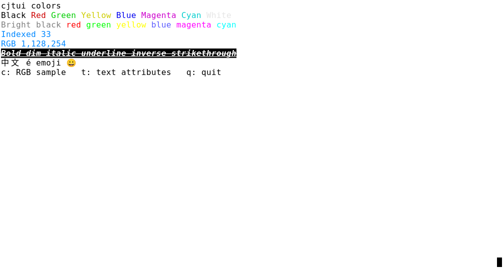
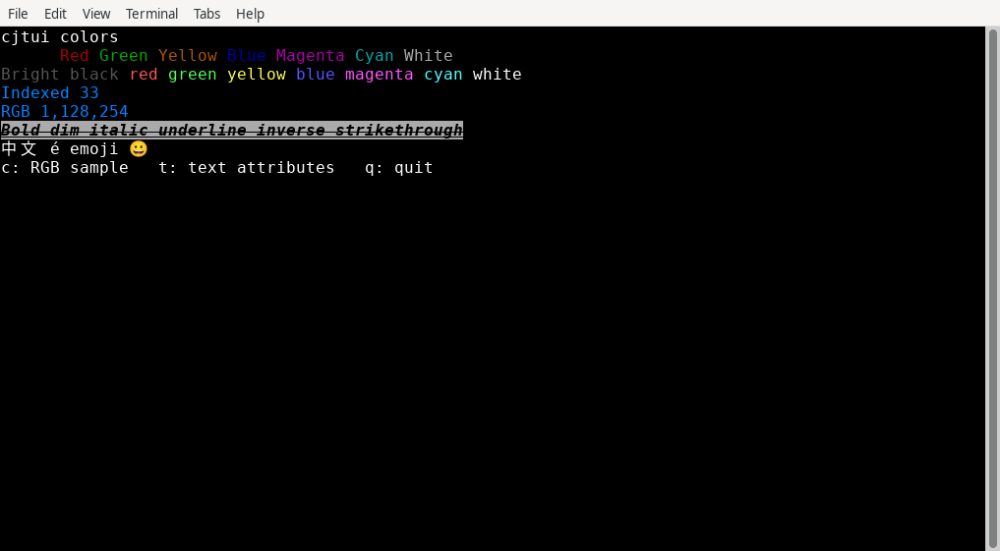

# R10 自动颜色与属性输出：测试报告

本轮实现默认自动降级：应用使用完整 `Color`/`Style`，`Application(root)` 根据宿主声明及可选 terminfo 适配颜色与六种文本属性；离线 `Frame.toAnsi()` 保留真彩与属性。产品版本为 `0.0.0`。最终技术版本 `8af39f6` 已完成独立审核，[逐需求验收](acceptance/report.md)已确认有限功能范围；最终集成元数据另行核对。

## 实际执行结果

| 检查 | 实际结果 | 原始证据 |
| --- | --- | --- |
| 独立冷构建、检查、全部切片与公开示例检查 | exit 0 | [cold 原始日志](execution/raw/stage-a-cold-slice.log) / [退出记录](execution/raw/stage-a-cold-slice.meta) |
| 标准 `cjpm bundle`（含自带 lint） | exit 0 | [bundle 原始日志](execution/raw/stage-a-bundle.log) |
| 本轮有限归档核对、解包构建/检查、干净公开消费者 | exit 0；归档 62 个文件内容一致 | [执行报告](execution/report.md) |
| 统一无 override 应用的真实终端矩阵 | 3 配置 × q/异常/Ctrl-C，共 9 场景通过 | [矩阵原始日志](execution/raw/stage-b-real-fixture-bash.log) |
| 未修改的公开 `examples/colors` | 3 配置通过；颜色/属性切换、尺寸变化、q 与恢复均有原图及 raw | [公开示例原始日志](execution/raw/stage-b-real-example.log) |
| 完整 release checker | exit 1：缺 composition；benchmark 亦待实现 | [完整检查原始日志](execution/raw/stage-a-full-bundle-check.log) |

冷回归和制品实际受检于 `ead6a8d`，GUI 实际受检于 `bf308bf`。产品、切片及制品输入内容相同；最终测试入口的 Bash/版本元数据修正通过[独立第三轮复核](auto-review/final/round-3-review.md)，原执行版本和原件归属保持不变。[逐命令记录及范围](execution/report.md)与[归档范围](execution/COPY_SCOPE.md)说明复用依据。

## 两种真实终端实现、三个配置

| 配置 | 实际宿主 | 自动结果（统一 fixture 的独立诊断） | 实际字符网格 |
| --- | --- | --- | --- |
| xterm-default | XTerm 398 | Basic8 / terminfo | 100×28 → 120×34 |
| xterm-256color | XTerm 398（同一引擎另一配置） | Indexed256 / terminfo | 100×28 → 120×34 |
| xfce-vte | XFCE Terminal 1.1.4-1 / VTE 0.80.1-1 | TrueColor / terminfo+COLORTERM | 100×28 → 120×34 |

xterm 的两行计为同一实现的两个配置。每个场景保留原始 PNG、输入与尺寸事件、ANSI、完整输出围栏、应用/宿主退出码和内外 PTY 的 termios。异常场景实际出现应用退出 1、宿主退出 0，由 recorder 独立判断。宿主版本查询的原始 Gtk 错误及[版本补证](execution/host-version-supplement.json)同时保留。

## 公开示例运行效果图

以下为真实窗口原始 PNG；场景均是未修改的 `examples/colors` 初始界面。时间采用北京时间（UTC+08:00），由原始采集记录换算。普通示例没有 fixture 的诊断接口，其颜色效果与统一 fixture 的能力验证分别取证。

### xterm-default

XTerm 398；100×28；采集记录 2026-11-10T19:53:49+08:00；受检源码 `bf308bfccb43d0e88305c6d0ec64b4a92adbc892`。

PNG SHA256：`014143548a03625c279d87e0b99e19716e4fb99162ee0ab5f76055e5c6012e18`。

[原始 metadata](execution/terminals-example/xterm-default/q/metadata.json) · [尺寸变化后原图](execution/terminals-example/xterm-default/q/example-resized.png) · [原始 ANSI](execution/terminals-example/xterm-default/q/inner-tty.raw)

### xterm-256color

XTerm 398（同一引擎另一配置）；100×28；采集记录 2026-11-10T19:53:52+08:00；受检源码 `bf308bfccb43d0e88305c6d0ec64b4a92adbc892`。

PNG SHA256：`9b515ae2dc6cc0c04ed59826c88c9ce1132c0cfb009cc50bfb0c05a8c41c4ec7`。

[原始 metadata](execution/terminals-example/xterm-256color/q/metadata.json) · [尺寸变化后原图](execution/terminals-example/xterm-256color/q/example-resized.png) · [原始 ANSI](execution/terminals-example/xterm-256color/q/inner-tty.raw)

### xfce-vte

XFCE Terminal 1.1.4-1 / VTE 0.80.1-1；100×28；采集记录 2026-11-10T19:53:54+08:00；受检源码 `bf308bfccb43d0e88305c6d0ec64b4a92adbc892`。

PNG SHA256：`d4f4d2e3710f1632415e1e03150585cc706e5ec1ea10d7ded8e23e9a714b995e`。

[原始 metadata](execution/terminals-example/xfce-vte/q/metadata.json) · [尺寸变化后原图](execution/terminals-example/xfce-vte/q/example-resized.png) · [原始 ANSI](execution/terminals-example/xfce-vte/q/inner-tty.raw)

## 独立审核、失败证据与验收边界

[首轮审核失败](auto-review/round-1/review.md)、[最终审核](auto-review/final/round-3-review.md)、[测试工具与修复原始证据](test-repairs/report.md)均保留。新增 Auto 初始 RED 的完整原日志未留存，已用固定历史产品 `187e126` 和冻结测试[重新取得缺 API、默认快照、旧公开示例三类真实失败](test-repairs/evidence/red-reproduction/README.md)，明确标为本次重现。

本轮仅覆盖颜色/属性/自动降级及相关回归。完整 Linux 组件、主题、M2 等仍按总计划实施；Windows、macOS、HarmonyOS 尚待后续。物理 Linux console、tmux、screen 缺真实宿主，保持待验。截图反映本次宿主和字体，不保证所有终端的字形覆盖或自定义调色板一致。

[执行副本逐文件 SHA](execution/SOURCE_SHA256SUMS.txt) · [GUI 原件逐文件 SHA](execution/GUI_SOURCE_SHA256SUMS.txt) · [任务状态](../../../openspec/changes/implement-color-style-output/tasks.md)
