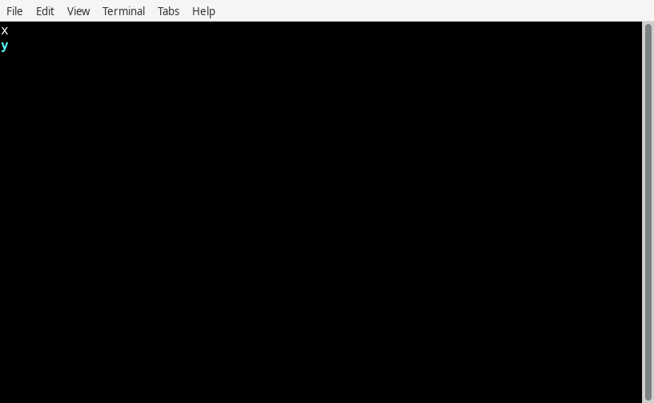
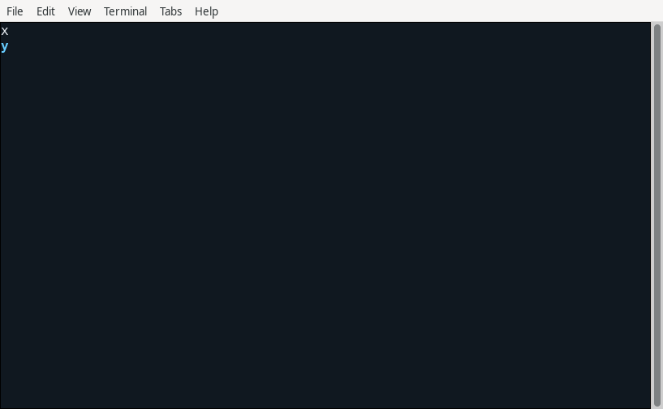
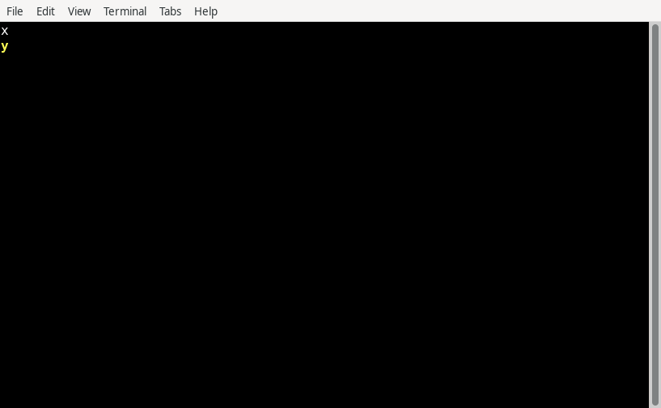
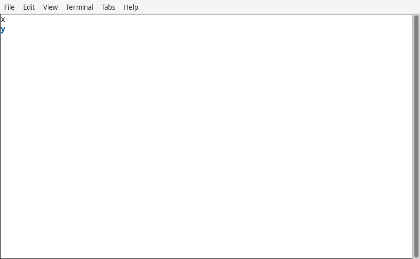

# Theme013/025 基础交付证据

独立088对固定 `8d75233c664fd61be08d441f74d464cbcdff2d9c` 的当前 Theme 基础范围给出 `PASS_FOUNDATION_SCOPE`，当前无未关闭 C/I/M。以下是普通公开 `Application.run` 冻结 x/y 基础场景的原始截图，不代表027完整控件、窄屏、交互或 showcase。

XTerm398 使用普通 `TERM=xterm` 基本色自动投影；XFCE1.1.4/VTE0.80.1 使用普通 `xterm-256color`，其256/RGB路径不同。这是两个真实终端实现，不能把配置数当成实现数。截图未生成、重绘或另存副本。

| Theme | XTerm398 原图 | XFCE/VTE 原图 |
| --- | --- | --- |
| Classic |  |  |
| Dark |  |  |
| HighContrast |  |  |
| Light |  |  |

Glyph实际原图：[XTerm Ascii](execution/raw/gui-glyph/xterm-Ascii/preset.png)、[XTerm Unicode](execution/raw/gui-glyph/xterm-Unicode/preset.png)、[VTE Ascii](execution/raw/gui-glyph/vte-Ascii/preset.png)、[VTE Unicode](execution/raw/gui-glyph/vte-Unicode/preset.png)。12张PNG只在 execution 保存；acceptance 不重复复制。

审查与结果链：[初版086问题](code-review/report.md) → [round1修正审核](code-review/round1/report.md) → [cleanup闭环](code-review/cleanup-closure/report.md) → [087独立执行](execution/report.md) → [088独立基础验收](acceptance/report.md)。历史失败、首次核验器失败和准备期 `NOT_ASSESSED` 均保留；初审并未改写为PASS。

`T087-G01` whole checker 实际退出1：themes allowlist 与缺少 composition/benchmarks 使最终023 release 门禁保持 OPEN。基础包与当前范围通过不代表完整Linux、M2、026/089异步生命周期或027全控件通过。

C1负例的产品输入哈希在执行后取得，旧compiler没有pre-run二进制记录；有限复用不追认不存在的执行前身份，也不声称负例在最终8d重跑。lock旧hash与最终hash的差异已由相同五条完整requires记录的排列证明为顺序变化，精确版本未变；这不是恢复旧原始lock或补出历史pre-run证据。原metadata与失败输出未改。

各子包的 archive-index.json 提供本次完整 source→archive/SHA 列表和原外部provenance/省略记录位置。未复制产品源码树、SDK/stdx、CJP/ELF/CJO、缓存、生成输入大树、完整源Markdown或私钥。
