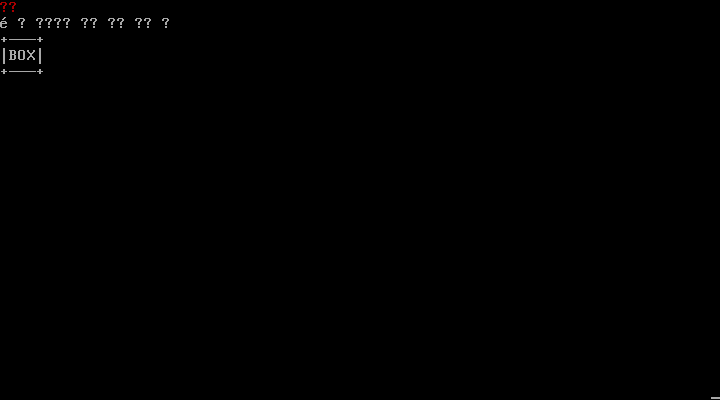
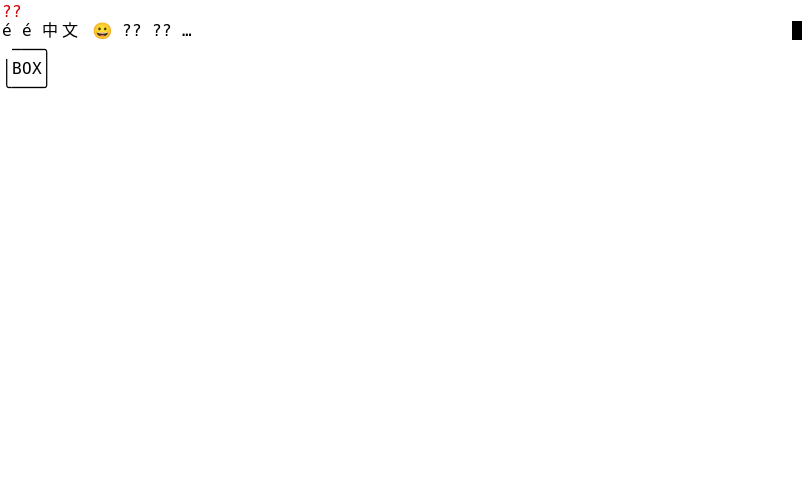
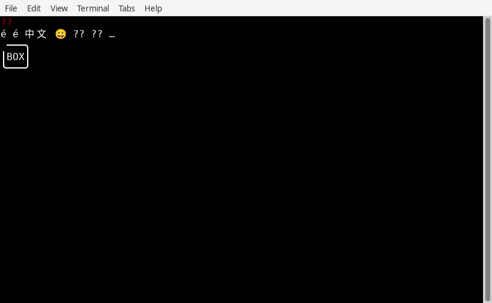

# Linux 字形适配：测试报告与原图

[独立验收报告](acceptance/report.md)接受固定 TASK093–097 的有限字形范围；[逐项矩阵](acceptance/acceptance-matrix.md)保留后续范围。[独立执行报告](execution/report.md)记录真实 Linux VT、XTerm 和 VTE 的测试条件、结果及失败尝试；[代码审核](code-review/report.md)记录固定代码的独立检查。

以下图片直接引用测试采集的原始 PNG。完整 39 张 PNG、21 份 QMP 原始 PPM、原生屏幕数据及哈希见[执行归档索引](execution/archive-index.json)。QEMU 运行真实 Linux 内核及 tty1；其虚拟硬件结果不外推到所有物理设备。切换 `TERM` 的分支测试不计为另一种终端实现。

## Linux VT：普通用户、默认自动降级

## XTerm：默认自动降级

## VTE：默认自动降级

本轮没有关闭完整 Linux、M2、全量会话恢复或主题省略号布局验收；这些范围继续由各自任务负责。
