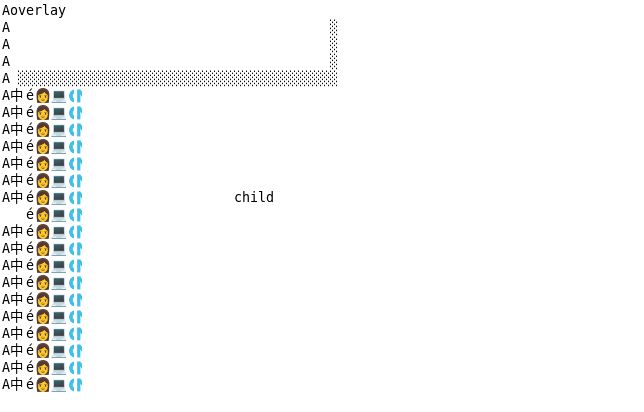
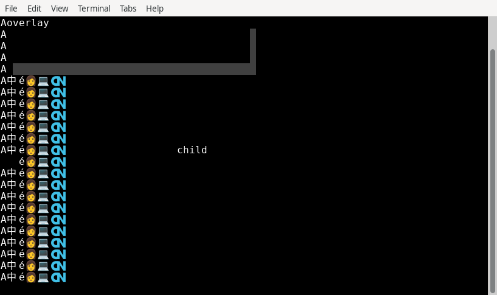

# Original final M2 capture gallery

Twelve unchanged original PNGs. [Complete run/PID/source/ELF/time/hash metadata](capture-metadata.json); all 852 accepted/historical originals remain in [raw evidence](raw-evidence.tar.gz). Captures are representative lifecycle observations, not presentation-time measurements.

