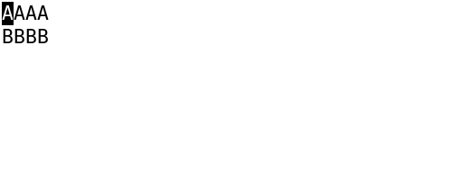
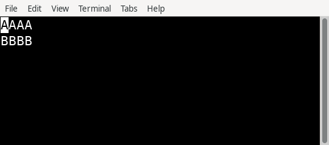

# Unit A 普通焦点域与光标交互证据

独立102对固定 `f8a028b39daf8a341576f304335d262544b9cca5` 给出 `PASS_FINITE_UNIT_A`，当前0C/I/M。root已另行完成main集成与字节等价核对；本次仅归档，不改产品、测试或任务状态。parent017只在普通域focus范围接受；B/C、完整Keyboard、widgets/edit、M2、全Linux和023仍OPEN。

审查链：[100初审](TASK-100/report.md) → [round1](TASK-100/round1/report.md) → [round2最终sourceQA](TASK-100/round2/report.md) → [101最终执行](TASK-101/report.md) → [102有限验收](TASK-102/report.md)。f02/6f历史findings与失败保原状态，不因最终PASS改写。

测试补充：[098final](TASK-098/final/final-report.md)、[readonly correction](TASK-098/readonly-correction/report.md)、[review regressions](TASK-098/review-regressions/report.md)、[clock transition](TASK-098/clock-transition/report.md)。既有 [prepared098](TASK-098/manifest.json) 与 [R17preflight](../../R17/initial-focus/addendum.md) 只链接，不重复旧原件。

## 成功run原始图：六个host/原始状态

以下literalAAAA/BBBB是测试画面，不是完整控件showcase027。原PNG没有重画、拼接或另存；截图中的原blink相位不被解释为静止光标保证。

| Host / 原始状态 | 原图 | 范围 |
| --- | --- | --- |
| XTerm398 / original visible |  | GUI原图，blink相位按采集时刻保留。 |
| XTerm398 / original hidden |  | 成功hidden run；不把截图相位改成预期。 |
| XFCE1.1.4/VTE0.80.1 / original visible |  | 成功visible run；原caret/blink状态如实保留。 |
| XFCE1.1.4/VTE0.80.1 / original hidden |  | 成功hosts3run，不使用失败hosts2hidden采集。 |
| Linux VT / original visible |  | fenced完整2000cellVCS+cursor证据；Unknownquery不发25控制。 |
| Linux VT / original hidden |  | 同样使用hosts2完整fence，保原hidden模式。 |

最终成功原PNG计74=GUI48+VT26。索引另保留32张失败/替代采集原图，共106；旧未fenced `vt-hosts` 与失败 `gui-hosts2/vte-hidden` 不是正确物理oracle，未用于上表。GUI来自XTerm两态、VTEvisible与hosts3hidden；VT正确物理结果只来自 `vt-hosts2`。不重复旧Glyphfixture图。

Linux VT是QEMU中真实内核6.12.107、uid1000、tty1，不是物理机/物理键盘认证。Unknown query分支没有产品25h/l/s/r字节，保持原生可见模式，同时logical caret/CUP继续。guest内置ShiftTab实际映射HT；真实CSI Z/Backtab证据来自GUI/真实PTY，不伪称guest键盘已证明。

执行包含实际87Acase，7futureKeyboardcase明确未执行。review15单列，其中12headless已在默认执行重复，不额外加unique计数。实际197CJP成员hash/560warnings保留；外部CJP/ELF/SDK/VMtar/base64不复制。023wholechecker旧allowlist/composition/benchmark门禁不升级为releasePASS。

所有原failedattempt、helper错误与采集失败保留。15项home/cache不入仓，原manifest仍保原条目并在省略映射列出精确外部source/hash/reason。历史畸形JSON如有，保原字节与错误，不修/删来宣称全JSON有效。

[轻量根索引](archive-manifest.json) 指向各子包完整source→copy/hash与省略映射。没有运行suite、npm、额外review或产品验证。
