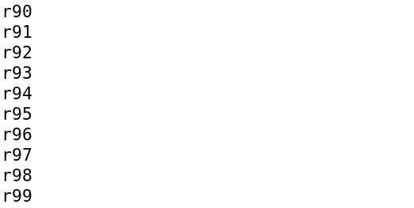
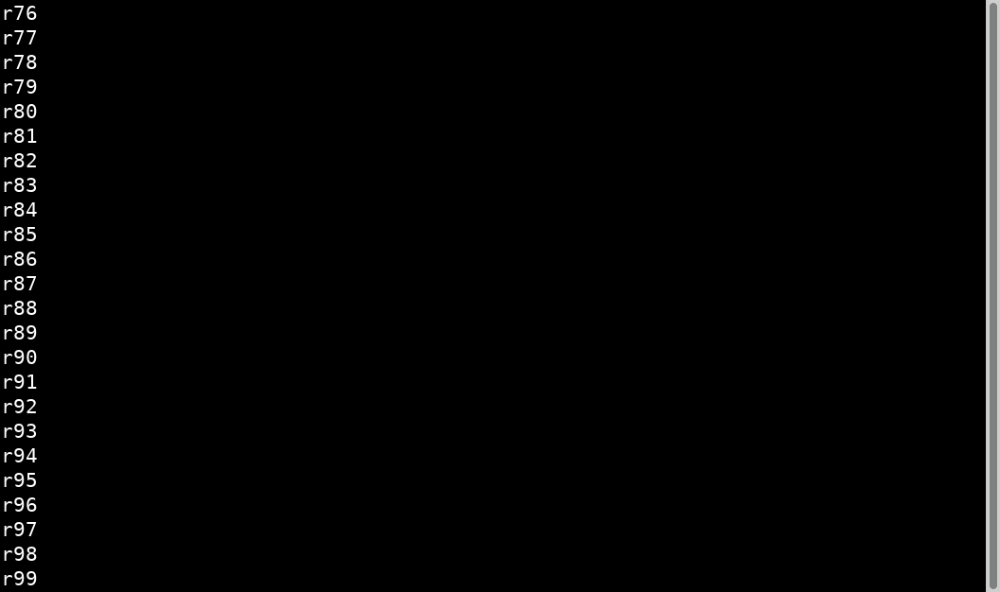
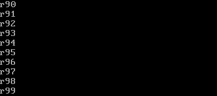

# Unit B viewport / scroll / caret 证据

独立107对固定 `62039552a26da295dcd710d7cfc40cb9e43ca5fd` 给出 `PASS_FINITE_UNIT_B`，0C/I；`T105-M01` exact getter/onMount axes 仍 `DEFERRED_TASK024`：已知onMount初始Off，start返回后Both，constant axes零几何PASS不能替代该义务。42矩阵行是41当前通过+1M01待办义务，不是41个唯一测试。

root已机械cherry七个产品提交到main `9cfaaa24ac694403417bc55f36fac89137cd26d5`，并单独核对源码/正式测试字节等于620；没有产品修正或新cold运行。这里仅新增归档说明，不改原验收记录。

证据链：[105初审](TASK-105/report.md) → [round1](TASK-105/round1/report.md) → [最终round2](TASK-105/round2/report.md) → [106执行](TASK-106/report.md) → [107有限验收](TASK-107/report.md)。[103最终准备](TASK-103/final/report.md)、[正式handoff](TASK-103/admission/report.md)、[ThemeCanvas原probe](TASK-103/theme-canvas-probe/report.md)/[正式回归](TASK-103/theme-canvas-regression/regression-report.md)、[driver readiness](TASK-103/driver-readiness/report.md)、[review regressions](TASK-103/review-regressions/report.md)/[round2](TASK-103/review-regressions/round2/report.md)、[NR](TASK-103/node-reference-regression/report.md) 分别保原scope。[旧103prepared](TASK-103/manifest.json) 与 [A](../A/README.md) 不重复归档。

## 六张成功run代表原图

截图是viewport/scroll/caret/resize功能证据，原blink相位和可见状态按采集时刻保留，不重画、不裁拼；不是027用户应用Theme完整控件showcase。

| 真实host / 场景 | 原始PNG |
| --- | --- |
| XTerm398：scroll/resize tail |  |
| XTerm398：same-turn caret/resize |  |
| XFCE/VTE：scroll tail |  |
| XFCE/VTE：natural caret resize |  |
| Linux VT：scroll/resize tail |  |
| Linux VT：same-turn caret/resize |  |

[全部91张成功原图与8张历史失败/替代图索引](screenshots.md)。91=64GUI+27真实LinuxVT，不把配置数当成终端实现数；旧失败采集不提升为正确oracle。

Linux VT在QEMU中运行真实Debian6.12.107内核、uid1000、tty1、VCS/VCSU/QMP/strace；不是物理硬件或物理Page键认证。物理PageUp/PageDown仍待117，VT完整Unicode字体覆盖不由本轮扩张，先前Glyph有限scope保持。

正常mandatory bundle：208成员同固定源码，CJP SHA256 `7aae8c78c6bac15a6dd618a8616646b3bbc23feb3c54d79d1f610d8799474885`；618warnings原样保留，不称lint-clean。clean full B、NR、T008及example实际0，不能替代后续scope。

M01精确待办、023wholechecker themes allowlist/composition/benchmark、M2、全Linux与release仍OPEN；完整Keyboard/widgets/edit、C与027showcase后续。早期NR真GREEN及fresh96RED、所有helper/失败采集原件状态不改。

[轻量根索引](archive-manifest.json) 记录各稳定原manifest及copyhash。外部40artifact/SDK/CJP/ELF/cache/VM/程序源只保provenance，不复制wholeworkspace或正式tests树；NR11个独立GC变体小型公开测试源保留，实际ELF/objects/CJP仍外部。未读取104作者自评/报告。
