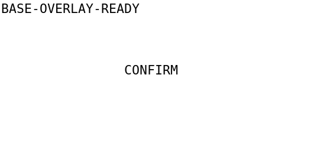
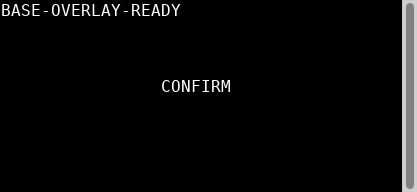
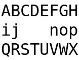
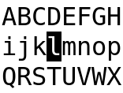

# Unit C — accepted finite archive

Independent [TASK112 acceptance](overlay-acceptance/acceptance.md) is **PASS_FINITE_UNIT_C** for C-01–C-05 and the full original parent TASK018 AC. Accepted product `7f43176505aa3c392afc5fc897181a9eeba89e6e` was mechanically integrated as main `283e59b15b6e6b094e409b185bbf01b38b9a9d79`; [original-to-main map](C-product-integration-map.json) preserves all ten identities. No product or suite was rerun to build this archive.

The immutable [111 stable manifest](overlay-execution/stablemanifest.json) remains byte-identical (`cda293604be2e912103e0358c3fcd28f7c24af4511337b591d1036ee0a592ad2`); its 4,639 originals / 433,699,788 bytes were freshly verified by independent112 with zero differences. [112 evidence index](overlay-acceptance/evidence-index.json) SHA256 `bde6a33222a6ac7ed3df86199209b97ef73ab057427be6d8739f4d71d9dab511`; acceptance SHA256 `702cd9f253fbc005821920875eccc865f7cf1dfad4847c87ed13a27ef0d8c123`.

This is a filtered public evidence subset, not the complete execution workspace. [Source path map](evidence-path-map.json) maps every copied original to its public location and byte hash. [External omissions](external-omissions.json) records every excluded111 original and QA-bound external input with original path/hash/reason. Full product/contract snapshots, SDK, caches, compiled ELF/CJP/object files and VM/initrd images remain external. Original manifests/reports retain their original references and bytes; absolute workspace references resolve through the path map or omissions, not by rewriting history. Raw `.bin` files here are original terminal replies/termios bytes, not renamed executables. Guest evidence tar and serial base64 tar members were inspected for forbidden payload.

[Execution report](overlay-execution/report.md), [raw command index](overlay-execution/raw-index.json), [artifact identity index](overlay-execution/artifacts-index.json), [failure index](overlay-execution/failure-index.json) and [original omissions](overlay-execution/omissions.json) preserve chronology. [Initial QA](overlay-review/report.md), [R1](overlay-review/round1/report.md), [R2](overlay-review/round2/report.md), [R3](overlay-review/round3/report.md), and reviewed technical diffs in [source-review](source-review/) preserve the independent review trail. Author self-assessment is excluded; only exact immutable-QA-bound author pure raw is included.

The pre-existing [TASK108 blocked preparation](TASK-108/manifest.json) and its66 files remain unchanged as earlier history; it is not current acceptance.

The [test preparation](overlay-tests/final-preparation/report.md), [language-only declaration supplement](overlay-tests/final-preparation/declarations/report.md), [admission](overlay-tests/admission/report.md), [83 Option.None syntax correction](overlay-tests/type-correction/report.md), [four contract-based depth fixtures](overlay-tests/depth-correction/report.md), [two export/turn REDs](overlay-tests/export-turn-regressions/report.md), [ten review REDs](overlay-tests/review-regressions/report.md), [two Round2 REDs](overlay-tests/review-regressions/round2/report.md), and [controlled-PTY native caret supplement](overlay-tests/native-caret/report.md) remain separate original identities. Old wrong fixtures, baseline compile failures, collector failures and f331 mandatory lint failure remain historical evidence; they are not relabelled PASS.

Formal/H01/clean test `3fcba825c6739fdfa6f4204b033866f864160d2b` aliases primary freeze `7469f27e5715829ba44d07463378f07a1eb89323`. H01 ELF SHA256 `087db92082f4630d41bd7e183b0f5e16e50274455d2fda564c151cf533d27d68`. Native caret freeze `eea178fe0c8866a50e4a641f4df0f34769a67051` ran in independently combined `abd0ef62a6d4a45fa2c30de2d19dcb7ead8d89a8`, product-byte-equal to7f, using ELF `a4663f3ad288cb931b0d8b43e8df9b42f54b621a9e8fce3fff5e801b401ce3c0`. Clean consumption did not run the new native caret vector. CJP SHA256 `49dabd23f71bb7c8ede00949fbc836afef6875130d732dc6e9a0177deecc247f` has220 source-equal members; CJP payload stays external. These are distinct binaries and test scopes.

[Final image index](final-images.json) contains all **71 distinct original paths**:51 accepted H01 plus20 native caret. Equal pixel hashes may occur at different paths. [Historical image index](historical-images.json) separately contains125 preliminary/historical/transient originals, including earlier product fixtures and an environment capture; these are neither all failed nor all final successes. Each index entry gives the actual SHA256, source identity and scope. The examples below are original, unmodified PNGs.

| Original capture | Image |
|---|---|
| XTerm H01 confirmation |  |
| VTE H01 confirmation |  |
| QEMU Linux kernel VT H01 confirmation |  |
| XTerm native caret base |  |
| XTerm native caret opaque cover |  |
| XTerm native caret restored |  |

XTerm398/VTE0.80.1 provide actual known-reply hide/show/CUP evidence. QEMU10.0.13/Linux6.12.107 kernel VT is a **VM, not physical hardware**. VT physical caret hiding remains **insufficient_evidence**: its Unknown capability produced zero25h/l/s/r commands and correct logical occlusion, satisfying I015 automatic degradation. Its image is not proof of physical hiding. Official shared viewer was not verified.

Historical external limits remain explicit. The124 R1 compiled intermediates have exact original and last-cleanup hashes/reasons in the [external intermediate wrapper](validation/overlay-review-external-intermediates-20261113.json) and [cleanup receipt](validation/ended-overlay-intermediates-before111-cleanup-20261113.json):121 matched,3 were replaced by subsequent builds before cleanup. They were not reconstructed. Old author mutable manifest SHA71a28… /7d8b… has no retained exact snapshot; byte size is unknown. Current54a799… is not substituted. Immutable QA manifests directly bind the included exact pure raw and git source identities.

Acceptance closes only finite C and the full original AC018. B-M01 remains deferred024. Menus/standard Modal019, editing/widgets, full theme showcase027, complete restore020, final packaging023/024, M2, whole Linux and Windows/macOS/HarmonyOS remain pending; H02 cross-layer paste awaits Keyboard117. This archive does not expand that acceptance.
