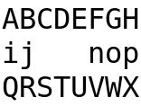

# TASK-111 独立有限 Linux 执行

**SCOPED PASS；LinuxVT 的物理 caret 隐藏为 insufficient_evidence（Unknown 自动降级），不声称隐藏成功。** 全部指定实际执行已结束。
产品固定 `7f43176505aa3c392afc5fc897181a9eeba89e6e`；正式/clean/H01 为7469测试的root alias3fcba825。独立caret为eea178fe，仅四个测试文件组合至同产品（own HEAD abd0ef62），产品字节相同；旧H01未重跑或重标身份。
独立SDK1.2.0/config/cache；命令cwd、UTC、stdout/stderr、真实exit、源码/config和bin前后hash见 [raw-index.json](raw-index.json)。保留全部编译/lint警告，不使用作者target或包。
正常正式C入口exit0；正常 mandatory lint/build/test/bundle（无skip）exit0。CJP SHA256 `49dabd23f71bb7c8ede00949fbc836afef6875130d732dc6e9a0177deecc247f`，220成员逐个等于7f固定源码。
干净解包后完整C消费者及公开examples/overlay均fresh build0、direct binary0（例子--smoke）；只改manifest依赖path，其余全部source前后相同，见 [package证据](raw/package/package.json)。clean范围是原7469消费者，不冒称包含后补caret分支。
H01独立PTY五模式与XTerm398、VTE0.80.1、QEMU10.0.13/kernel6.12.107三个真实实现各五模式均通过；实际binary0/trace/cleanup/termios有raw。VM并非物理硬件。见 [15宿主模式](raw/final-h01-index.json)。
H01 ELF=`087db92082f4630d41bd7e183b0f5e16e50274455d2fda564c151cf533d27d68`；新增caret ELF=`a4663f3ad288cb931b0d8b43e8df9b42f54b621a9e8fce3fff5e801b401ce3c0`；均独立保存于artifacts/7f。
独立caret三宿主均binary0、cleanup1/resources0、termios恢复：8×3原生网格→opaque三空格→关闭恢复；公开logical snapshot与immutable/saved诊断一致。XTerm/VTE真实original-visible回复及hide/show/CUP/原态恢复通过，无合成reply；VT unknown-timeout且框架25h/l/s/r全部零。

| AC | 结论与实际范围 |
|---|---|
| C-01 | PASS：完整正式C域/路由断言；H01真实modal→popup→confirm、trace与app/legacy0、Escape/prevent/interrupt/SIGINT。 |
| C-02 | PASS：完整C的owner隐藏卸载、依赖闭包/兄弟、焦点恢复和Round2 FIRST/NEXT对照；H01真实退出cleanup一次。 |
| C-03 | PASS（能力策略范围）：完整C手工golden/透明/主题/host/anchor/caret；新增真实三宿主opaque向量。VT物理隐藏不足明确保留。 |
| C-04 | PASS：完整C pending/stale/非法关系/异常断言；H01真实callback primary+两cleanup异常身份/顺序及恢复。 |
| C-05 | PASS：完整C同SettingsPanel/model两实例与children/状态断言；干净包完整公共消费者和例子实际运行。 |

复用仅未变上游有限事实：native/decoder等19文件、SDK800、deps375、stdx371前后hash相同；旧B/主题/runtime证据保原SHA/角色，参见 [复用映射](input-preparation/final-reuse-map.json)，未冷跑历史全套或抄旧截图。
历史失败未抹除：f331正常bundle1的11条mandatory错误经上游修复；GUI PID/首帧及VT半行reader失败、clean staging baseline路径假设失败只修外部collector；一次错误baseline检出仅编译1、从未执行。详见 [failure-index.json](failure-index.json)。
原始成功/失败/瞬时PNG均按原件分类保存；某次首帧失败发生在PNG创建前，缺图明确登记，未重建。可查看 [原生base](raw/caret-gui-c/xterm/base-0.png)、[opaque遮挡](raw/caret-gui-c/xterm/covered-0.png)、[关闭恢复](raw/caret-gui-c/xterm/restored-0.png)。

边界：官方共享viewer未验证，不影响实际X display；Windows/macOS/HarmonyOS、完整widgets/编辑/M2、物理硬件VT不在本次执行范围。未发布、未改正式产品/测试/契约/main；测试补丁仅在独立组合检出应用。
交付：[stablemanifest.json](stablemanifest.json)、[artifacts-index.json](artifacts-index.json)、[external-hashes.json](external-hashes.json)、[omissions.json](omissions.json)；本报告不代替TASK112验收裁决。
