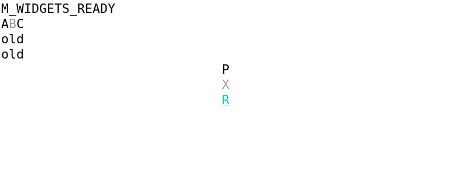
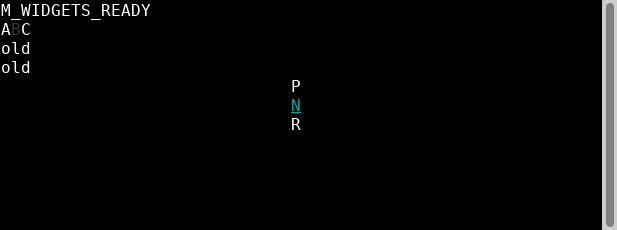
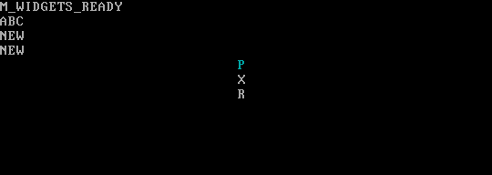

# Composite widgets — finite M accepted

`HorizontalMenu`, `PopupMenu`, `StatusBar` and `SplitPane`, with `MenuEntry` and `SplitAxis`, are delivered through the public component construction API. See the [usage guide](../../../product/widgets.md), [composition example](../../../../examples/widgets_composition/src/main.cj), [public menu factory](../../../../src/horizontal_menu.cj) and [source/main alias map](main-map.json).

Independent TASK162 concluded **PASS_FINITE_M**, with specification, quality and evidence PASS for M01–M05 and affected S02: [original acceptance](acceptance162/acceptance.md), [condition matrix](acceptance162/ac-results.json), [immutable index](acceptance162/index.json). Root adopted that verdict before integrating author `6f7d6feeb18b714d10300505d02e163d97b6c68a` → accepted source `6e3f26aaaeee9442fde91ce31d720a841eeda473` → main `c5a875f09cbb4f6fdb49eefaff14343e0d519630`. Tests remain `ad100b79956de30fe65c6d561f11be67186821d5` / tree `ff16e53ffe8156950088fd3c7d4654f972c830cc`. Product version remains `0.0.0`.

[Independent160 review](review160/report.md) found zero contract defects and one open nonblocking suggestion, **M160-S01**, concerning exact error-code precision in a test. It is retained and not claimed fixed. [Independent161 execution](execution161/report.md) supplies its own normal package, clean consumer/example, 53 headless cases, PTY product exits 0/21/22 and six actual device/example runs across XTerm398, VTE0.80.1 and QEMU10.0.13/kernel6.12.107 VT. [Author159 evidence](author159/task-159-report.md) is separately labelled developer proof.

The [original158 report](test158/report.md), [initial index](test158/evidence/index.json) and [separately issued corrections](test158/corrections/README.md) preserve genuine missing-API RED, failed compiler/setup/contracts, wrong restore expectations and payload-race FAIL-9 history. Later results never rewrite those originals. [Admission](admission/report.md) and the prior [finite S archive](../S/README.md) retain their own dates and scope.

[Copy receipts](source-copy-index.json) map original absolute paths to archive paths, bytes and SHA256; [excluded files](excluded-originals.json) and [external input references](external-input-references.json) identify retained local compiler inputs/binaries/packages/SDKs. The typing proof's [canonical snapshot map](test158/corrections/device-typing-fix/evidence/public-snapshot-map.json) and [snapshotted index](test158/corrections/device-typing-fix/evidence/index-snapshotted.json) retain 37 canonical owner-input snapshots locally. Historical observed producer paths may later be rebuilt or absent; they are not the retained canonical locations. Original Markdown and reviewer contract/source hierarchy remain byte-preserved; [navigation map](navigation-map.json) identifies small labelled redirects. [Committed Git context](git-context-index.json) is source context, not runtime proof.

Actual GUI mode25 naturally reports known-visible 1 before/after; kernel VT naturally gives no reply, emits no25 controls and keeps physical cursor visibility **Unknown**. Artificial unanswered-wire tests do not make actual GUI visibility Unknown. The kernel host is a VM, not physical hardware. VT Shift-Insert is key transport evidence, not clipboard or paste capability acceptance.

Native M is ASCII/default Classic, including disabled B/X skip/projection. Literal Unicode and explicit palettes are headless/source evidence; four-theme/all-state/Unicode integrated showcase remains TASK027/041. Raw focus23/choose4/model NEW/cleanup1/resources0 and exact termios/60×12→50×10 resize receipts establish behavior; images alone do not accept Linux.

All **65 original PNGs** have hashes/status in the [complete original catalogue](execution161/raw/final-verification/original-png-catalogue.json). These three settled originals are navigation selections, unchanged and uncomposited:

TASK153–162 finite S/M roles are complete. Parent019/011 full AC and parent020/030, full M1 recovery/composition, 027/041, M2, whole Linux, B-M01→024, T087→023 and release remain open. Continue [008/010/020/021/027 integration → M2 → final Linux](../../../linux-completion-plan.md). This evidence publication reuses unchanged inputs under AGENTS11.1 and performs no functional reruns.
