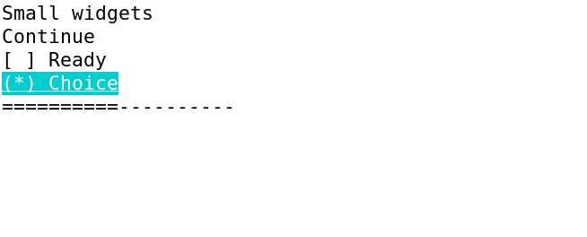
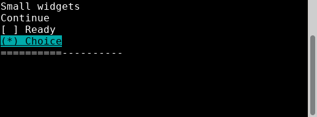

# Finite S public widgets evidence — 2026-11-13

`Label`, `Button`, `Checkbox`, `Radio` and `Progress` are delivered through public component composition, controlled getters/request callbacks, shared Text/Canvas/theme/focus primitives and the existing lifecycle. Independent TASK157 accepts **PASS_FINITE_S** for S01–S05 and AC029's five-widget semantic scope: [acceptance](widgets-small-acceptance/acceptance.md), [requirement matrix](widgets-small-acceptance/requirement-matrix.md), [original index](widgets-small-acceptance/index.json). Public usage: [basic widgets](../../../product/widgets.md), unchanged `examples/widgets_small`.

Accepted source `1df1325f7b51777d8adab62f950c936051aa5876` maps to main product head `85998ead2b53cb8e6a6ab8c69e5e3efb8739411f`. Root verified source/native/build/package configuration/examples/tests/widget-doc bytes equal; [exact source/test aliases](controller/main-map.json) preserve original SHAs. Version remains 0.0.0. The [final input manifest](input-manifest.json) retains original upstream provenance; its [previous issued bytes](controller/history/input-manifest-before-final.json) and existing [admission report](admission/report.md) remain historical evidence.

TASK153–157 are complete within finite S. M158 is next independent formal test work: M tests, actual prerequisite verification and RED are not yet delivered; 159–162 remain planned. The formal OpenSpec change remains active. Integrated all-state/Unicode/four-theme showcase027/041, M/parent019/020/030, fullLinux/M1/M2 and release remain open; B-M01→024 and T087→023 remain pending.

## Original independent evidence and author proofs

- TASK153: [frozen tests and prerequisite/target RED](widgets-small-tests/final/report.md), [original evidence index](widgets-small-tests/final/evidence/index.json), [historical preparation](widgets-small-tests/report.md). Seven separately issued corrections remain original: [typing](widgets-small-tests/typing-fix/report.md), [contract exceptions](widgets-small-tests/contract-fix/report.md), [explicit palettes](widgets-small-tests/palette-fix/report.md), [initial theme](widgets-small-tests/initial-theme-fix/report.md), [zero-width frame](widgets-small-tests/zero-frame-fix/report.md), [committed focus fixture](widgets-small-tests/focus-fixture-fix/report.md), [PTY tool import shadowing](widgets-small-tests/pty-tool-fix/report.md). All corresponding original indices/raw remain beside their reports. Genuine setup/compiler/contract/fixture/PTY-start failures are retained, not replaced by later pass output.
- TASK154 [author implementation report](widgets-small-implementation/task-154-report.md) and [final author evidence index](widgets-small-implementation/evidence/final-index.json) are development proof, distinct from independent156 execution and157 acceptance. Failed phases, logs and later qualified results remain unchanged. No missing historical state was reconstructed.
- TASK155 independent [specification/quality PASS](widgets-small-review/report.md), [zero findings](widgets-small-review/findings.json), [immutable reviewed inputs](widgets-small-review/round-0/inputs.json) and [verification](widgets-small-review/round-0/verification.json). Progress measure reads constraints/Size(20,1) without reading fraction; this is source proof, not an inference from screenshots. LEGACY-PROP-001 preserves only the documented legacy constant-property exception; typed/getter/resolved validation remains strict.
- TASK156 [independent execution report](widgets-small-execution/report.md), [final sealed index](widgets-small-execution/final-index.json), [final verification](widgets-small-execution/raw/final-verification/verification.json) and [source bindings](widgets-small-execution/raw/source-bindings/phase-index.json). Own ordinary build/bundle exited0 without skip flags. CJP SHA256 `bdddec69975aca4d87766fe1cc26d6f1e97450e3189c63013838506858e445f6`:253 safe source-equal members; clean consumer retains36 unchanged frozen test inputs. Built-in bundle tests were0; actual independent runner supplies behavioral evidence. Unchanged runner exited0, actual normal/callback/getter PTY exits0/21/22 match frozen expectations, exact error sentinels/cleanup1/resources0 and paired native-mode restoration are retained. Two forbidden Bool constructors fail compilation as expected. Intentional target-red.sh was not run against the finished product.
- TASK157 [independent acceptance](widgets-small-acceptance/acceptance.md), [requirements](widgets-small-acceptance/requirement-matrix.md), [original-file receipts](widgets-small-acceptance/original-SHA256SUMS) and [selected-original check](widgets-small-acceptance/selected-evidence-check.json) judge the finite requirements; case counts and author reports do not substitute for this verdict. Lint suggestions remain documented; no lint-clean claim is made.

## Representative settled original captures

Six new actual runs exercised the unchanged example and frozen device on XTerm398, XFCE Terminal/VTE0.80.1 and QEMU10.0.13/Linux6.12.107 kernel tty1. Each direct product exited0 and restored termios exactly. Native keys observed Enter button once, HT+Space checkbox once/true, HT+Enter Radio once/true and no extra callback for already-selected Radio. Actual GUI XTEST→host PTY and QMP keyboard→kernelVT input paths establish host diversity, not TERM substitution.

[All 50 original PNGs with hashes and status](png-catalog.md), also [JSON](png-catalog.json), retain captured bytes; native `*-vcsa.bin` data stays beside VT PNGs. Early VT checkbox focus capture lags and is excluded as settled focus proof; later PNG/native vcsa observations agree. Transition/restoration filenames alone establish neither settled frames nor cleanup; the raw result and termios records control those claims. No screenshot was generated, redrawn or composited.

New native S captures cover **ASCII captions/default Classic only**. Unicode captions, disabled and explicit/custom palette behavior is strict headless S plus independent source155 evidence. Accepted byte-unchanged [E backend projection](../../E/README.md) is qualified mechanism reuse, not new native S Unicode coverage. Full native all-state/Unicode/four-theme integration remains027/041. QEMU is a VM, not physical hardware. Progress measure readsets are source-proven; native images do not prove measure dependency isolation or unchanged M1 measure counts.

## Provenance, exclusions and checks

[Source-copy index](source-copy-index.json) maps every copied original absolute path to archive path, byte count and SHA256, and separately labels fixed Git contract blobs under their [original hierarchy](controller/openspec/changes/implement-standard-widgets/design.md). These are committed contracts, not reconstructed execution outputs. Three immutable source-review contract snapshots also retain their original repository hierarchy; relocations and explicit routing pages are mapped in the source-copy index without changing original bytes. [Exclusions](exclusions-index.json) identify omitted indexed artifacts and retained-original locations. Whole source/worktree/SDK/dependency/cache/target copies, ELF/libraries/objects/CJP and redundant guest archives are excluded; native vcsa/termios observations remain. Existing admission and K/E/C originals are preserved; prior archives are referenced rather than copied again. Official registry URLs and truthful local paths remain; inspected actual config snippets contain no credentials.

This is a mechanical archive/status task: no functional tests/builds, product edits or repeated asset/source review. [Strict OpenSpec validation](archive-validation.txt) and [archive checks](archive-checks.json) record scoped verification. Full repository Node/link/task checking is deferred to root's complete checkout because this sparse worktree omits historical archives. Original raw whitespace/CRLF is retained; only authored metadata is checked for whitespace.
